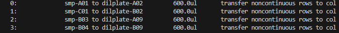
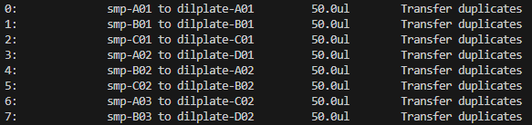
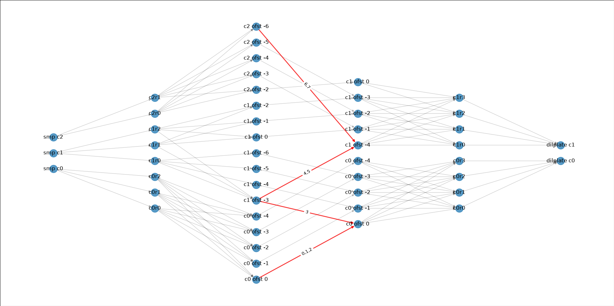

## Optimisation Algorithm Details

The optimiser uses a graph representation of labware, columns, rows, and offsets, then uses the edges between offsets to calculate potential pipetting moves.

For the operations:


The following graph is produced


We use this graph to calculate pipetting operations that can be conducted in a single move of the pipetting arm, and find the operation with maximal efficiency.

The left 3 columns are the 'source' side. There is a node for each column in each labware. As the pipetting arm has 8 tips in a column, it can only access 1 column in 1 labware at a time. So this is the first layer of division.

Each of these columns has (usually 8) rows. The rows that have pending pipetting operations have nodes created. The associated labware + column node has an edge going to the rows contained within that column. Here, smp column 0 has pipetting operations in row 0 and row 2 (A01 and C01). The other columns have only 1 row relevant.

Each column in a plate may be accessed with the tips offset in the y direction. With the default offset of 0, each tip is above its corresponding row. With an offset of +7, tip 8 is above row A. With an offset of -7, tip 1 is above row H. To show a simpler graph for this example, offset_limit_up and offset_limit_down are each set to 2 in the labware objects, which limits the possible offsets from -2 to +2.

Edges are created from each row, to each offset which can address this row. The graph shows all possible assignments as edges. smp `c0r0` and smp `c0r2` can both be aspirated with an offset of 0, so they have red edges to the 'smp `c0 ofst 0`' node. As we are aspirating row 0 and row 2 with an offset of 0, this will use tip 0 and tip 2. This node represents a single 'aspirate'.

The 4th column also represents an offset, but on the 'dispense' side. From aspirate `c0 ofst 0`, 1 edge goes to dilplate `c1 ofst 0` - this is labelled with a 0, as it represents op 0 (the transfer from A01 to A02). However the other edge for op 1 goes to a different offset, because we are transferring to a different row - C01 to B02. As tip 2 aspirated C01, and it now needs to dispense to B02, it must do this with an offset of -1, so the edge goes to dilplate `c1 ofst -1`. Thus, this single aspirate node links to 2 dispense nodes, and 2 dispenses are required.

These dispense nodes then have edges back to the respective rows of the dispense plate. These rows are then linked to nodes representing the column of the dilution plate.


### Move Calculation
A key advantage of this approach is the ability to consider multiple nodes at both the source and destination at the same time, and combine them into a single move. Consider another example, with ops:


The operations here go from 3 columns on one plate to 2 columns from another plate. However the rows are misaligned such that source column 2 goes to 2 different destination columns. A naive approach might transfer ops 0-3 directly (1 aspirate and 1 dispense), then do 1 aspirate and 2 dispenses to cover ops 3-5, then another direct transfer for ops 6-7, taking a total of 3 aspirates and 4 dispenses. The optimiser can do this in 3 aspirates and 2 dispenses. Let's look at the graph generated.



Here, edges that will be relevant to our move are highlighted red for legibility, but there is nothing special about them at the beginning of the process. As before, offsets are limited to reduce the number of nodes drawn.

Any offset node, on the source or destination side (columns 3 or 4) can be used as a starting point to create a move. We make a list and loop through, creating one move per starting node. 

Here, the dispense node `c0 ofst 0`, representing column 0 offset 0 for the dilution plate, has 4 out-edges - meaning it can dispense to 4 rows with a single offset. This makes it a good candidate to produce a good move. However, it has edges to 2 aspirate nodes, so doing all 4 of these dispense rows would require 2 aspirates.

We create a list of edges going into this node, and sort them by the number of ops assigned to that edge. We look at the first edge in the list - this is the edge `c0 ofst 0 -> c0 ofst 0`. This contains ops `0,1,2` - labelled. We add these ops to our move.

We now have a valid move with 3 operations. However we still have empty tips, so we want to look for other operations we can combine to use the other tips. We select the next edge from the list, `c1 ofst -3 -> c0 ofst 0`. This edge contains op 3. We add this to the move, so now we have 2 aspirates and 1 dispense covering ops 0-3.

However unlike the previous node, `c1 ofst -3` has other out edges - meaning that more than just op 3 can be aspirated with this offset. The edge `c1 ofst -3 -> c1 ofst -4` contains ops 4 and 5. We add this edge to our list. This edge is now the only item in the list, so we process it next, and add ops 4 and 5, with a dispense at `c1 ofst -4`. This node also has another in-edge - the edge `c2 ofst -6 -> c1 ofst -4` which contains ops 7 and 8. As it is pipetting rows A and B to rows C and D, the difference in the offsets must be +2 to line the rows up correctly. We add this final aspirate to the move, and now we have a finished move covering all 8 ops with 3 aspirates and 2 dispenses.

Similar moves are generated from each starting-point node. Then, the best move is selected by giving each move a score.
```
# Score the efficiency of the move, penalising moves that need more
# distinct aspirate/dispense groups relative to the ops they cover
num_actions = len(self.aspirates) + len(self.dispenses)

# 0.25 weight on actions tested to perform well on range of use cases
self.score = (
    len(self.ops) - (1 if self.wash_first else 0) - 0.25 * num_actions
)
```
Moves are scored based on which coveres the most ops, with a penalty for requiring a wash, and another for the number of aspirates/dispenses taken.

Let's compare the top two moves generated here.
```
# Move 1
aspirates = {('smp', 1, -3): [4, 5, 3], ('smp', 2, -6): [6, 7], ('smp', 0, 0): [0, 1, 2]}
dispenses = {('dilplate', 1, -4): [4, 5, 6, 7], ('dilplate', 0, 0): [3, 0, 1, 2]}
ops = [4, 5, 6, 7, 3, 0, 1, 2]
tips = [4, 5, 6, 7, 3, 0, 1, 2]
wash_first = False
score = 6.75

# Move 2
aspirates = {('smp', 0, 0): [0, 1, 2], ('smp', 1, -3): [3, 4, 5]}
dispenses = {('dilplate', 0, 0): [0, 1, 2, 3], ('dilplate', 1, -4): [4, 5]}
ops = [0, 1, 2, 3, 4, 5]
tips = [0, 1, 2, 3, 4, 5]
wash_first = False
score = 5.0
```
The top move is the move we demonstrated, with 8 ops accomplished in 3 aspirates and 2 dispenses. This scores `8 - 0 - (0.25 * 5) = 6.25`. The second move, from a different traversal, completes 5 ops across 2 aspirates and 2 dispenses. This scores `5 - 0 - (0.25 * 4) = 4`. So, our move is chosen.

This calculation is important as adding more operations is not always worth the move cost. For example, if there is only one tip left, adding another aspirate in order to use this tip may not be worth it if this operation could be completed in a larger group when tips are not as constrained. New ops becoming open after old ops are completed can also create better groups later down the line.

This algorithm does not exhaust every possible combination - if there are multiple edges that could be added to the move, these are sorted first by if a wash is needed (no wash preferred), then the number of ops attached to that edge, which corresponds to how many ops the additional move will add. This is a greedy approach, and it is possible that choosing one edge with fewer ops will allow a later choice with more ops, but with many possible offsets, the potential combinations of edges grows very large, and this greedy approach performs very well in testing. Sufficient variability is established by the exploration of all nodes - these will produce a range of different edge orders for the algorithm to choose from.

You may also note that only the 'offset' edges, labelled with ops, are actually used in calculating moves. The other edges, used to construct and visualise the graph, are not actually needed. Thus by default `OpGraph.py` has a flag `DEBUG=False` which avoids storing these edges. `DEBUG=True` can be set to store these edges, which allows full graphs, as seen here, to be viewed using the `show_graph()` function - usage in docstring.
